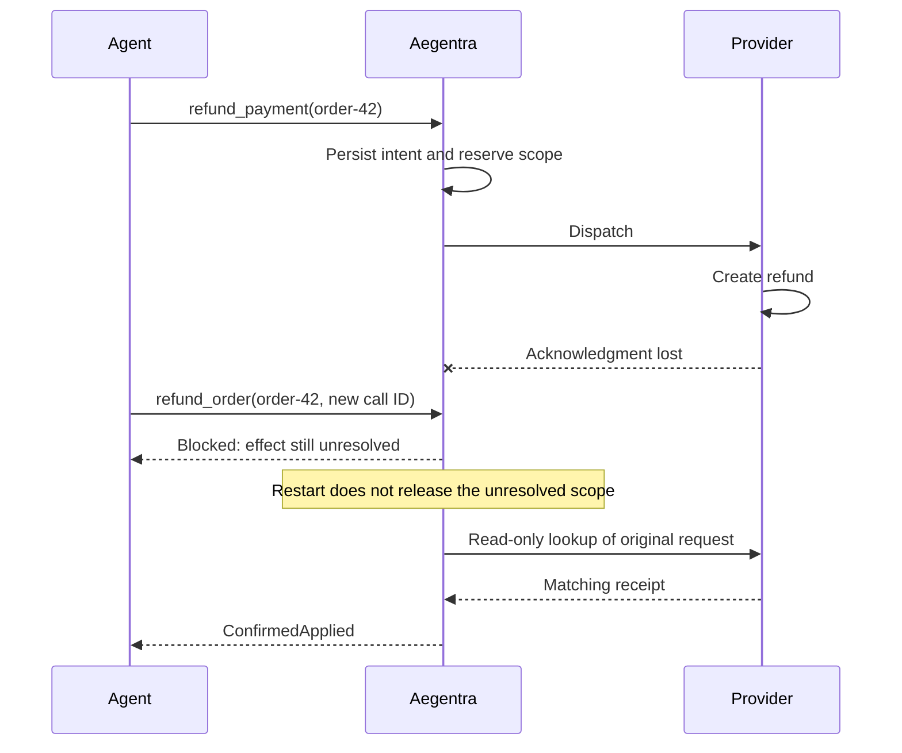

# Aegentra

### A timeout is not permission to try again.

[](https://github.com/DebasishMaji/Aegentra/actions/workflows/ci.yml)
[](pyproject.toml)
[](LICENSE)
[](docs/research.md)

An agent requests a refund. The provider processes it. The response disappears.
The agent tries a different tool with a fresh call ID. Now there are two refunds.

**Aegentra puts a durable boundary between an uncertain outcome and the next
write.** It records the authorized intent before dispatch, blocks new writes in
the same application-declared effect scope while the outcome is unresolved, and
reconciles through provider evidence.

Python 3.11+ | Standard-library core | Optional LangGraph integration | macOS and Linux

> [!IMPORTANT]
> Research alpha, not a production payment integration. This version permits one
> possible dispatch per operation; it does not retry writes. Business identity
> and provider observations come from trusted application adapters.

[Run the demo](#watch-the-failure-happen) |
[LangGraph integration](docs/langgraph.md) |
[Use the API](#put-a-boundary-around-a-write) |
[Evaluate the fit](#when-is-this-worth-integrating) |
[Read the contracts](#design-and-research)

## The identity that a retry key can miss

The agent's tool call is not necessarily the business operation.
`refund_payment` and `refund_order` may produce the same effect despite having
different call IDs. Aegentra can connect them through a shared scope:

```text
tenant / provider account / order / refund
```



The application must declare that shared scope. Aegentra does not infer equivalent
actions from names, arguments, or model judgments. Provider-side idempotency
remains valuable; this boundary is not a replacement for it.
A settled scope is not a permanent deduplication key: a new, independently
authorized operation can write again.

## Watch the failure happen

With [uv](https://docs.astral.sh/uv/) installed:

```sh
git clone https://github.com/DebasishMaji/Aegentra.git
cd Aegentra
uv sync --locked
uv run python examples/adversarial_testing.py
```

**No API key, model, or external service.** The model-free testing agent explores
a persistent refund sandbox, checks actual provider effects independently, and
reduces a failing trace. Selected lines from the default run:

```text
Discovered scenario: lost_acknowledgment
Found actions: replan -> advance -> observe
Reduced 3 actions to 1 using 5 fresh probes; single-deletion minimal: True.
Reduced actions: replan
```

The demo then runs the reduced case against both clients:

| Replay | Actual refunds | Final client knowledge | Invariant violations |
|---|---:|---|---|
| Unsafe client, reduced case | 2 | Applied | Duplicate effect; false terminal claim |
| Aegentra, identical case | 1 | Unknown | None observed |
| Aegentra, extended recovery trace | 1 | Applied | None observed |

**Safety is not completion.** The identical replay remains unresolved behind
Aegentra. The third row is a separate input that adds `advance -> observe` to
obtain confirmation. The unsafe client is deliberately defective, not a strong
research baseline.

This search is specific to the included sandbox. It does not test arbitrary
third-party agents or establish universal safety.

<details>
<summary><strong>Save a counterexample and replay it from the CLI</strong></summary>

```sh
# Expected exit 3: an invariant violation was found.
uv run aegentra test-agent --case-out counterexample.json > search-report.json

# Expected exit 3: the same failure reproduces.
uv run aegentra replay-test counterexample.json --target unsafe_retry

# Expected exit 0: no invariant violation in this bounded replay.
uv run aegentra replay-test counterexample.json --target aegentra
```

Case files must be new. Reports are JSON on stdout; operational errors go to
stderr. Exit 0 is not a safety proof. See the
[testing-agent contract](docs/adversarial-testing.md) for budgets, artifact
validation, and the precise meaning of single-deletion minimality.

</details>

## Use your existing LangGraph tool node

The optional integration exposes an application-approved operation as an async
LangChain `StructuredTool`, usable in a LangGraph `ToolNode`:

```sh
uv sync --locked --extra langgraph
uv run --extra langgraph python examples/langgraph_refund.py
```

The example runs a **real compiled graph** through a lost acknowledgment, an
alternate tool proposal, and reconciliation after restart. The tool choices are
scripted; it does not call a model or payment service.

`operation_tool` snapshots the approved payload when bound. Its input schema has
no arguments: the model cannot change the operation ID, scope, approval, or amount.
Results explicitly distinguish confirmation, uncertainty, and blocking. The core
package still has no third-party runtime dependencies.

See the [integration guide](docs/langgraph.md) for graph wiring, async ownership,
error handling, and the difference between tool execution and business success.
Checkpoint-resume coverage also recreates the graph after reopening the runtime:
the replayed tool reconciles its original reservation without another refund.
The application must preserve both its graph checkpoint and live journal.

## Put a boundary around a write

Create the operation in trusted application code, after authorizing its payload:

```python
from aegentra import EffectScope, Operation, Runtime

operation = Operation(
    operation_id="refund-42",
    scope=EffectScope("tenant-a", "payments", "order-42", "refund"),
    approval_ref="approval-42",
    arguments={"amount_minor": 5000, "currency": "USD"},
)
```

Inside an async function, pass your adapter implementing `Tool`. `refund_tool`
below is your integration, not a bundled production connector:

```python
with Runtime("agent.sqlite3") as runtime:
    outcome = await runtime.perform(operation, tool=refund_tool)
```

There is no success-shaped fallback. Handle the outcome explicitly:

| Outcome | What the application may conclude |
|---|---|
| `ConfirmedApplied` | The adapter supplied matching applied evidence and a receipt. |
| `ConfirmedNotApplied` | The adapter established that this attempt cannot execute later. |
| `Unresolved` | Neither conclusion is established. Do not treat this as permission to retry. |
| `BlockedByUnresolvedEffect` | Another operation has an unresolved effect in the declared scope. |

Calling `perform` again with the same intent returns a settled result or performs
read-only reconciliation; it never calls `execute` again. Changing the bound
payload, approval reference, or scope raises `IntentConflict`. Recovery requires
the original tool name and contract version.

### The adapter is the trust boundary

| Adapter member | Responsibility |
|---|---|
| `name`, `contract_version` | Pin the route and its semantics to the operation. |
| `validate(operation)` | Reject invalid payloads or scopes before reservation. |
| `execute(record)` | Make one possible write and return an `Observation`. |
| `observe(record)` | Collect evidence without making another write. |

Use `Observation.unknown(...)` for inconclusive evidence. A missing record from
an eventually consistent endpoint is not enough for `Observation.not_applied(...)`:
that requires excluding late execution.

Aegentra checks observation identity and payload binding, not the truth of an
adapter's assertions. [`RefundTool`](src/aegentra/sandbox.py) is a working
reference. Its provider deliberately omits deduplication so duplicate effects
remain visible.

<details>
<summary><strong>Bound recovery without authorizing another write</strong></summary>

Inside an open runtime:

```python
from aegentra import RecoveryBudget

outcome = await runtime.recover(
    operation.key,
    tool=refund_tool,
    budget=RecoveryBudget(max_observations=3, timeout_seconds=5.0, interval_seconds=0.25),
)
```

Exhaustion returns `Unresolved` and records `recovery_exhausted`. It neither
releases the scope nor permits a retry. The deadline is cooperative: it cannot
forcibly stop blocking adapter code.

For a single explicit lookup, use
`await runtime.reconcile(operation.key, tool=refund_tool)`.
`runtime.inspect(operation.key)` returns the durable record;
`runtime.events(operation.key)` returns its ordered history.

</details>

## Inspect the decision, not just the exception

Run the restart-and-reconciliation example and retain both databases:

```sh
uv run python examples/refund_recovery.py --directory ./refund-demo
uv run aegentra list refund-demo/agent.sqlite3 --knowledge all
uv run aegentra trace refund-demo/agent.sqlite3 \
  --tenant shop --account payments --operation-id approved-refund-42
```

The directory must be new. The recorded event sequence is:

```text
dispatch_reserved -> observed_unknown -> effect_blocked -> reconciliation_started -> observed_applied
```

The blocked proposal remains attached to the original operation, including the
requested operation ID, tool, and contract version, even after reconciliation.
Its rejected payload and approval reference are not copied into the event.

`list`, `inspect`, and `trace` use read-only snapshots without taking the writer's
ownership lock or migrating journals. Lists default to unresolved operations.
JSON output has pagination cursors; the Python `Inspection` API supports a
consistent snapshot across pages. Arguments and receipts require
`--include-payload`; metadata and adapter reasons can still be sensitive.

### Operate a controlled worker without silent state loss

Use `Runtime(path, require_existing=True)` after deliberate journal provisioning.
Missing or uninitialized state then fails instead of becoming a fresh ledger.
Read-only diagnostics and full-database inspection archives are available:

```sh
uv run aegentra status refund-demo/agent.sqlite3
uv run aegentra snapshot refund-demo/agent.sqlite3 \
  --out refund-demo/incident.sqlite3
uv run aegentra list refund-demo/incident.sqlite3 --knowledge all
```

Archives preserve committed WAL data, all tenants, and raw payloads; they are
private, checksummed, and **rejected by writable runtimes**, including older
versions. They are not safe rollback/failover state. See the
[embedded-worker runbook](docs/operations.md) for publication failures, monitoring,
and fail-stop recovery. This remains a research alpha, not a production endorsement.

## When is this worth integrating?

Consider it when an agent can replan a consequential write, the application can
assign a stable business-effect scope, and a trusted adapter can investigate the
original request. The value is enforcing the unresolved-effect boundary outside
the planner's policy.

Prefer your provider's idempotency and your existing runtime when those already
cover the failure. This alpha is not a workflow engine, hosted service, generic
agent-testing platform, or drop-in Stripe integration.

| Boundary | What this version does not guarantee |
|---|---|
| Delivery | Not exactly-once execution. A crash before sending can leave an operation unresolved even if nothing happened. |
| Authorization | `approval_ref` is an audit reference, not a verified permission token. |
| Coverage | Undeclared equivalent effects and writes bypassing the boundary are outside the model. |
| Agent output | The application must gate completion claims; arbitrary model text is not constrained. |
| Atomicity | The journal and external provider do not share a transaction. |
| Deployment | One process owns a journal; use local storage, one thread, and one event loop per runtime. |

Await or cancel active work before closing. Exceptions and cancellation propagate;
a reserved operation remains uncertain afterward. Journal contents are plaintext.
New database files are owner-only, not encrypted; existing permissions are
unchanged. Do not put credentials in arguments.

## Design and research

**Question:** does an agent preserve an unresolved business obligation when it
replans?

```sh
uv run aegentra lab > report.json
uv run aegentra lab --max-observations 1 > one-lookup.json
```

The fixed laboratory compares five scenarios under the same business identity,
lookup allowance, and evaluation horizon. It includes an unsafe retry, a competent
observe-or-stop policy, and Aegentra. Pending effects continue after a client stops.

**The competent baseline matches Aegentra on these single-process cases.**
The claim is an enforceable boundary, not superior recovery intelligence.
Durable execution, idempotency, and in-doubt states are established ideas.
No comparative model result, general performance advantage, or algorithmic
novelty is claimed.

| Read next | Contract |
|---|---|
| [LangGraph integration](docs/langgraph.md) | Bound operations, JSON outcomes, graph execution, and ownership constraints. |
| [Execution semantics](docs/semantics.md) | Dispatch reservations, crash boundaries, scope ownership, and schema upgrades. |
| [Recovery](docs/recovery.md) | Observation budgets, deadlines, and unresolved outcomes. |
| [Inspection](docs/inspection.md) | Read-only snapshots, event fields, pagination, and exports. |
| [Operations](docs/operations.md) | Fail-closed startup, diagnostics, inspection archives, storage protection, and recovery. |
| [Laboratory](docs/laboratory.md) | Controls, independent scoring, and matched comparisons. |
| [Testing agent](docs/adversarial-testing.md) | Feedback-guided search, shrinking, replay, and limits. |
| [Research gates](docs/research.md) | Prior art and the evidence needed for stronger claims. |

## Contributing

```sh
uv sync --locked --extra langgraph
uv run --extra langgraph pytest
uv run --extra langgraph ruff check .
uv run --extra langgraph ruff format --check .
uv run --extra langgraph mypy
uv build
```

Cases cover lost acknowledgments, delayed commits, alternate-tool replanning,
cancellation, and abrupt subprocess exit on both sides of the provider commit.
Read [CONTRIBUTING.md](CONTRIBUTING.md) before changing dispatch or finality rules.
An independently reproducible failure or a well-scoped adapter is more useful
than a broader reliability claim.

Licensed under [Apache 2.0](LICENSE). See [NOTICE](NOTICE) for attribution.